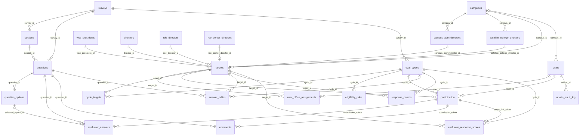

# Database schema reference

The fresh-install MySQL DDL is [database-schema.sql](./database-schema.sql).
It targets MySQL 8.0.16 or later for enforced `CHECK` constraints. This
reference describes the relationships and the backend's use of the tables.
The DDL creates the `evaluation_system` database; it is not an in-place
migration for an existing database.
For an existing database, apply
[20261123_remove_cycle_survey_snapshots.sql](./migrations/20261123_remove_cycle_survey_snapshots.sql)
to remove the obsolete cycle snapshot tables.

## Relationship diagram

In the diagram, `||` means exactly one, `o|` zero or one, and `o{` zero or
many. A target row has a typed reference to exactly one target-specific table;
the DDL enforces the type/reference match and each reference has a foreign key.
`target_catalog` is a read-only union view over those target tables.

## Table explanations

### Campuses and evaluation targets

| Table | Purpose and connections |
|---|---|
| `campuses` | Campus directory, with a unique code and location code, central-campus flag, and active status. Referenced by users and campus-specific target records. |
| `vice_presidents` | Directory of vice-president offices. A target can refer to a VP record. |
| `campus_administrators` | Campus administrator targets. Each belongs to a campus. |
| `satellite_college_directors` | Satellite-college director targets. Each belongs to a campus. |
| `directors` | General director targets not tied to a campus-specific director type. |
| `rde_directors` | Research, Development, and Extension director targets. |
| `rde_center_directors` | Director targets for individual RDE centers. |
| `targets` | Common evaluation target registry. A target points to exactly one of the six target-specific tables, with optional campus, central, and active flags, and an optional `office_head_name` holding the name of the designated office head being evaluated (for example, `Dr. Leo Andrew B. Biclar`; officers-in-charge are stored with an `(OIC)` suffix). The name is plain text, not a link to a user account, and one person can head more than one office. Cycles, assignments, participation, and aggregate results reference it. |
| `users` | Super-admin, admin, and evaluator accounts, authentication, campus, registration role, service range, and active status. Admin accounts manage the system and can view aggregate office means. Super admins are results-only and can access evaluator-level means and detailed results, but cannot manage system configuration or submissions. |
| `user_office_assignments` | Many-to-many links between users and targets, with `head` or `member` assignment role. Registration stores selected office/unit memberships as `member` rows; evaluator target listings and submission endpoints use those rows to restrict evaluable offices/units. |

### Surveys and evaluation setup

| Table | Purpose and connections |
|---|---|
| `surveys` | Survey title, description, version, and draft/published/archived state. Owns sections and questions and is selected by cycles. |
| `sections` | Ordered groupings of questions within a survey. Evaluator forms and results read the survey's current active sections and questions. |
| `questions` | Survey prompts, type, required/scale settings, order, scoring weight, and archive state. Belongs to a survey and section. Editing archives prior questions instead of deleting answer-linked rows. |
| `question_options` | Ordered choices and their scoring points for choice questions. `option_key` is unique within a question. |
| `eval_cycles` | Survey schedule, open/close times, status, response threshold, same-campus setting, and target category (or all categories). |
| `cycle_targets` | Join table selecting targets for cycles. Its composite primary key prevents duplicate assignments. |
| `eligibility_rules` | Retained cycle rule configuration; rules do not filter which targets an evaluator may submit to. |

### Participation, answers, and results

| Table | Purpose and connections |
|---|---|
| `participation` | Identity/participation ledger. One row per user, cycle, and target, with a unique random submission token. |
| `evaluator_answers` | Per-question answer values and optional scores, grouped by response ID. The submission token is a restricted deletion/review link; answers contain no user ID or email. |
| `comments` | Free-text comment and moderation status, linked to a question and submission token. It contains no user ID or email. |
| `answer_tallies` | Aggregate option counts by cycle, target, question, and option key. It contains no submission token or user ID. |
| `response_counts` | Aggregate submission totals by cycle and target. |
| `evaluator_response_scores` | Anonymous total, mean, and per-section scores grouped by response ID. Its private score-link token supports cascading deletion from participation. |
| `admin_audit_log` | Administrative actions and timestamps, linked to the acting admin account. |

## Views

| View | Purpose |
|---|---|
| `target_catalog` | Presents the six typed target tables as a single read-only catalog for the API. |
| `participation_counts` | Counts participation by cycle and target without returning individual ledger rows. |

## Privacy and deletion behavior

- Admin result/review queries must not join `evaluator_answers` or `comments`
  to `participation` or `users`. Review looks up the token separately and
  returns answer/comment content without the token or evaluator identity.
- The random submission token is present in `evaluator_answers`, `comments`,
  and the score-link field so deletion can cascade. Anyone with direct database
  access to both those tables and `participation` could correlate a submission;
  limit database credentials and do not expose tokens in answer responses.
- Deleting a submission retracts its tallies and response count, then deletes
  the participation row. Foreign-key cascades remove linked answers, comments,
  and score summaries. Evaluator-account deletion performs the same retraction
  for each of the user's submissions before deleting the account.
- Text answers and comments are redacted for email-like strings in review and
  result responses; free text can still reveal identity by its content.